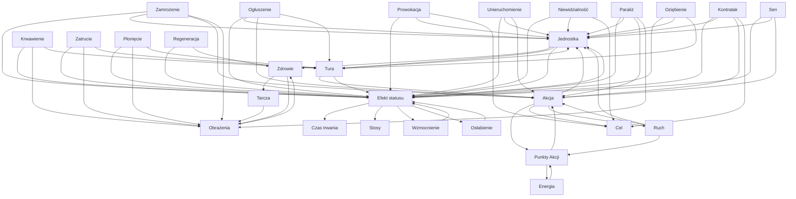

# Combat tooltip glossary graph

Robocze źródło prawdy dla pojęć używanych w combat tooltipach.

- Każdy węzeł jest jednym wpisem `CombatTooltipGlossary`.
- Strzałka `A --> B` oznacza, że opis A może i zwykle powinien linkować do B.
- Cykle są zamierzone. Tooltipy mogą otwierać kolejne tooltipy z tych samych pojęć.
- Opisy są kierowane do gracza: opisują konsekwencję w walce, nie wewnętrzny model danych.

## Katalog wpisów

Ta tabela jest gotowym źródłem tekstów dla `CombatTooltipGlossary`.
Wszystkie identyfikatory użyte w tagach `<link>` znajdują się w tej tabeli.

## Automatyczne linkowanie

`CombatTooltipGlossary` automatycznie zamienia nazwy wpisów i ich `Aliases` na
kolorowe linki, zanim opis zostanie pokazany. Ręcznie wpisane tagi `<link>` są
pozostawiane bez zmian. Dzięki temu zwykłe `obrażenia` lub `Jednostka` w opisie
stają się wejściem do kolejnego tooltipa bez ręcznego tagowania.

Do każdego wpisu warto dodać polskie odmiany używane w opisach, np. dla
`unit`: `jednostka`, `jednostki`, `jednostce`, `jednostkę`, `jednostką`.
Alias prowadzi do tego samego wpisu co nazwa główna.

| Id | Tytuł | Description |
|---|---|---|
| `unit` | Jednostka | Każda postać albo przeciwnik na polu walki. Jednostka ma `<link="health"><color=#B85A5A>zdrowie</color></link>`, wykonuje `<link="turn"><color=#B85A5A>tury</color></link>` i może otrzymywać `<link="status-effect"><color=#B85A5A>efekty statusu</color></link>`. |
| `health` | Zdrowie | Gdy zdrowie `<link="unit"><color=#B85A5A>jednostki</color></link>` spadnie do zera, zostaje ona pokonana. `<link="shield"><color=#B85A5A>Tarcza</color></link>` pochłania `<link="damage"><color=#B85A5A>obrażenia</color></link>` przed zdrowiem. |
| `shield` | Tarcza | Dodatkowa ochrona `<link="unit"><color=#B85A5A>jednostki</color></link>`. Pochłania `<link="damage"><color=#B85A5A>obrażenia</color></link>`, zanim zmniejszą one `<link="health"><color=#B85A5A>zdrowie</color></link>`. |
| `damage` | Obrażenia | Zmniejszają `<link="health"><color=#B85A5A>zdrowie</color></link>` celu. Najpierw są pochłaniane przez `<link="shield"><color=#B85A5A>tarczę</color></link>`, jeśli cel ją ma. |
| `turn` | Tura | Kolej `<link="unit"><color=#B85A5A>jednostki</color></link>` na działanie. W turze można wykonywać `<link="action"><color=#B85A5A>akcje</color></link>`; na jej początku i końcu mogą uruchomić się `<link="status-effect"><color=#B85A5A>efekty statusu</color></link>`. |
| `action` | Akcja | Działanie wykonywane przez `<link="unit"><color=#B85A5A>jednostkę</color></link>` podczas `<link="turn"><color=#B85A5A>tury</color></link>`, np. ruch albo użycie umiejętności. Zwykle kosztuje `<link="ap"><color=#B85A5A>Punkty Akcji</color></link>`. |
| `movement` | Ruch | Zmiana pola zajmowanego przez `<link="unit"><color=#B85A5A>jednostkę</color></link>`. Ruch jest `<link="action"><color=#B85A5A>akcją</color></link>` i zwykle kosztuje `<link="ap"><color=#B85A5A>Punkty Akcji</color></link>`. |
| `ap` | Punkty Akcji | Punkty wydawane przez `<link="unit"><color=#B85A5A>jednostkę</color></link>` na `<link="action"><color=#B85A5A>akcje</color></link>`. Nie są tym samym co `<link="energy"><color=#B85A5A>Energia</color></link>`. |
| `energy` | Energia | Klasowy zasób zużywany przez niektóre umiejętności. Energia i `<link="ap"><color=#B85A5A>Punkty Akcji</color></link>` są niezależne. |
| `target` | Cel | `<link="unit"><color=#B85A5A>Jednostka</color></link>` lub obiekt wybrany przez `<link="action"><color=#B85A5A>akcję</color></link>`. |
| `status-effect` | Efekt statusu | Tymczasowy stan `<link="unit"><color=#B85A5A>jednostki</color></link>`. Może być korzystnym `<link="buff"><color=#B85A5A>wzmocnieniem</color></link>` albo szkodliwym `<link="debuff"><color=#B85A5A>osłabieniem</color></link>`. Ikona pokazuje pozostałe `<link="duration"><color=#B85A5A>tury</color></link>`, a czasem także `<link="stacks"><color=#B85A5A>stosy</color></link>`. |
| `duration` | Czas trwania | Liczba `<link="turn"><color=#B85A5A>tur</color></link>`, przez które `<link="status-effect"><color=#B85A5A>efekt statusu</color></link>` pozostanie aktywny. |
| `stacks` | Stosy | Liczba nałożeń tego samego `<link="status-effect"><color=#B85A5A>efektu statusu</color></link>`. Zależnie od efektu stosy zwiększają jego siłę albo łączną wartość. |
| `buff` | Wzmocnienie | Korzystny `<link="status-effect"><color=#B85A5A>efekt statusu</color></link>` działający na `<link="unit"><color=#B85A5A>jednostkę</color></link>`. |
| `debuff` | Osłabienie | Szkodliwy `<link="status-effect"><color=#B85A5A>efekt statusu</color></link>` działający na `<link="unit"><color=#B85A5A>jednostkę</color></link>`. |
| `bleed` | Krwawienie | Szkodliwy `<link="status-effect"><color=#B85A5A>efekt statusu</color></link>`, który zadaje `<link="damage"><color=#B85A5A>obrażenia</color></link>` na początku każdej `<link="turn"><color=#B85A5A>tury</color></link>`. |
| `poison` | Zatrucie | Szkodliwy `<link="status-effect"><color=#B85A5A>efekt statusu</color></link>`, który zadaje `<link="damage"><color=#B85A5A>obrażenia</color></link>` na początku każdej `<link="turn"><color=#B85A5A>tury</color></link>`. |
| `burn` | Płonięcie | Szkodliwy `<link="status-effect"><color=#B85A5A>efekt statusu</color></link>`, który zadaje `<link="damage"><color=#B85A5A>obrażenia</color></link>` na początku każdej `<link="turn"><color=#B85A5A>tury</color></link>`. |
| `stun` | Ogłuszenie | Ogłuszona `<link="unit"><color=#B85A5A>jednostka</color></link>` nie może wykonywać `<link="action"><color=#B85A5A>akcji</color></link>` ani ruchu podczas swojej `<link="turn"><color=#B85A5A>tury</color></link>`. |
| `immobilize` | Unieruchomienie | Unieruchomiona `<link="unit"><color=#B85A5A>jednostka</color></link>` nie może się poruszać ani teleportować, ale nadal może wykonywać inne `<link="action"><color=#B85A5A>akcje</color></link>`. |
| `freeze` | Zamrożenie | Zamrożona `<link="unit"><color=#B85A5A>jednostka</color></link>` nie wykonuje `<link="action"><color=#B85A5A>akcji</color></link>`. Pierwsze trafienie zdejmuje Zamrożenie i zadaje większe `<link="damage"><color=#B85A5A>obrażenia</color></link>`. |
| `sleep` | Sen | Śpiąca `<link="unit"><color=#B85A5A>jednostka</color></link>` nie używa `<link="action"><color=#B85A5A>akcji</color></link>`. Poruszenie jej budzi ją ze snu. |
| `paralysis` | Paraliż | Sparaliżowana `<link="unit"><color=#B85A5A>jednostka</color></link>` nie może działać ani się poruszać. Nie otrzymuje również `<link="damage"><color=#B85A5A>obrażeń</color></link>`. |
| `chill` | Oziębienie | Szkodliwy `<link="status-effect"><color=#B85A5A>efekt statusu</color></link>`, który ogranicza szybkość `<link="unit"><color=#B85A5A>jednostki</color></link>`. Wolniejsze jednostki później dochodzą do swojej `<link="turn"><color=#B85A5A>tury</color></link>`. |
| `taunt` | Prowokacja | Sprowokowana `<link="unit"><color=#B85A5A>jednostka</color></link>` musi wybierać prowokującego przeciwnika jako `<link="target"><color=#B85A5A>cel</color></link>`, jeśli umiejętność na to pozwala. |
| `invisibility` | Niewidzialność | Niewidzialna `<link="unit"><color=#B85A5A>jednostka</color></link>` nie może być wybrana jako `<link="target"><color=#B85A5A>cel</color></link>` przez wrogie umiejętności. |
| `regeneration` | Regeneracja | Korzystny `<link="status-effect"><color=#B85A5A>efekt statusu</color></link>`, który przywraca `<link="health"><color=#B85A5A>zdrowie</color></link>` `<link="unit"><color=#B85A5A>jednostce</color></link>`, jeśli ma przypisaną wartość leczenia. |
| `counterattack` | Kontratak | Gdy przeciwnik zaatakuje `<link="unit"><color=#B85A5A>jednostkę</color></link>` będącą w zasięgu, odpowiada ona własną `<link="action"><color=#B85A5A>akcją</color></link>` przeciw temu `<link="target"><color=#B85A5A>celowi</color></link>. |

## Zasady redakcyjne

1. Każdy status linkuje do `status-effect`, `unit` oraz do konkretnej konsekwencji: `damage`, `action`, `target`, `turn` albo `health`.
2. Opis mówi najpierw **co gracz zauważy i co może zrobić**, potem ewentualny szczegół.
3. Nie używamy technicznych słów typu „instancja”, „runtime” ani „pipeline”.
4. `Punkty Akcji` zawsze linkują do `ap`; klasowy zasób zawsze do `energy` i jest w tekście nazywany Energią.
5. Gdy opis mówi o liczbie tur lub nałożeniach, linkuje odpowiednio do `duration` lub `stacks`.
